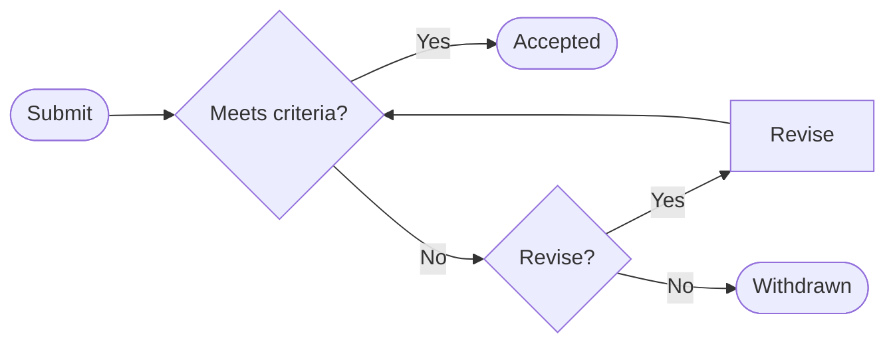
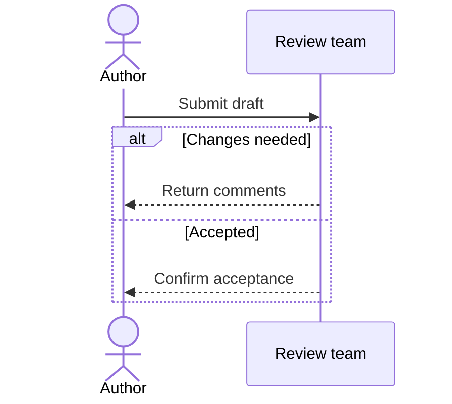
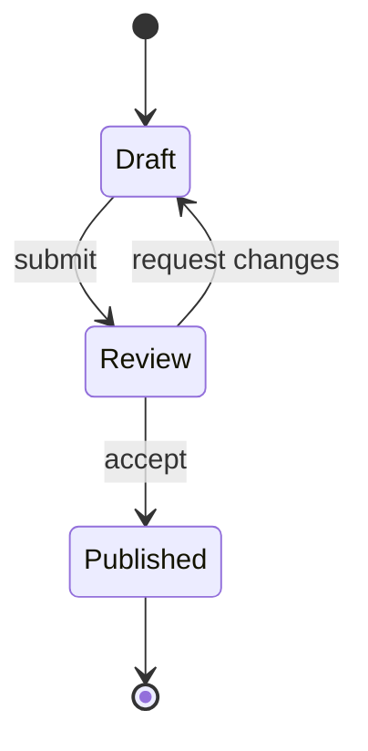

# Diagram patterns

Read the applicable pattern, not every linked manual. Links below are the official syntax authority; check the target renderer before adopting newer syntax. The examples are illustrative and do not assert a real business process.

## Process, branching, loops, and responsibility

Use [flowcharts](https://mermaid.js.org/syntax/flowchart.html) for steps and decisions. Rectangles denote actions, diamonds decisions, and rounded endpoints entry/exit. Label both outcomes and make a retry's stopping condition clear. Distinguish a feedback loop from an unintentional cycle.

For Chinese or punctuation-heavy labels use declarations such as `Check{"资料齐全？"}` with ASCII IDs. Avoid reserved lowercase `end` as an ID or bare label. Put spaces around connections to avoid accidental `o`/`x` arrow markers. Escape literal quotes using the supported entity syntax instead of concatenating untrusted labels into Mermaid instructions.

Use `subgraph` to group responsibility when an approximate lane view suffices. Mermaid's flowchart subgraphs are not guaranteed fixed swimlanes: links from internal nodes to the outside can override the group's direction. Inspect routing instead of assuming `direction` guarantees placement. For strict lane notation, confirm a compatible dedicated diagram type or agree on a different representation; do not call a loose grouping BPMN-compliant.

A fork in a flowchart does not by itself establish concurrency or a join barrier. Label the intended semantics, or choose a sequence/state diagram with supported parallel constructs. For static architecture, use nouns for components and label edges with their actual relationship; do not imply time order from placement.

## Exchanges and alternatives

Use a [sequence diagram](https://mermaid.js.org/syntax/sequenceDiagram.html) when ordering across participants matters. Declare participants in a readable order that reduces crossing; source order controls their placement. Use arrow types consistently and explain asynchronous messages if relevant. `alt`, `opt`, `loop`, and `par` represent actual alternative, optional, repeated, and concurrent behavior, not decoration. Replies must return to the appropriate caller; balance activation lifetimes if used.

## Lifecycle

Use [state diagrams](https://mermaid.js.org/syntax/stateDiagram.html) for legal state transitions. Label edges with events/guards, distinguish initial and terminal markers, and preserve cancellation or recovery when specified. Use explicit aliases for long display names. Composite states, choice, fork, and join should match real lifecycle semantics.

## Other common representations

| Type | Semantic check | Official syntax |
| --- | --- | --- |
| `erDiagram` | Verify optionality, multiplicity, keys, and identifying/non-identifying relationships; omit unknown cardinalities or flag them outside the diagram | [ER](https://mermaid.js.org/syntax/entityRelationshipDiagram.html) |
| `classDiagram` | Distinguish inheritance, realization, association, aggregation, and composition; do not infer ownership from a field name | [Class](https://mermaid.js.org/syntax/classDiagram.html) |
| `gantt` | Confirm date format, durations, task dependencies, and excluded days; distinguish supplied dates from illustrative ones | [Gantt](https://mermaid.js.org/syntax/gantt.html) |
| `timeline` | Preserve chronological order and supported dates; do not imply a proportional time scale | [Timeline](https://mermaid.js.org/syntax/timeline.html) |
| `mindmap` | Indentation expresses hierarchy, not causal order; confirm renderer support | [Mindmap](https://mermaid.js.org/syntax/mindmap.html) |

Do not assume diagram types share flowchart styling or accessibility syntax. Consult the specific type when adding configuration or exporting it.
